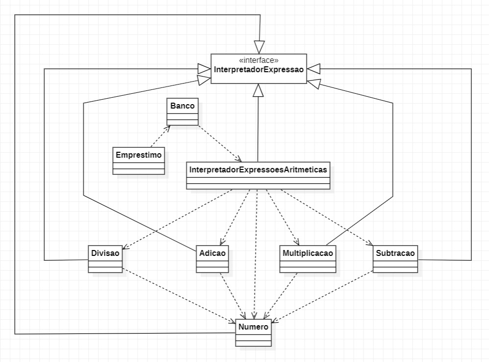

# Exercício Interpreter, Parcela de Empréstimo do Banco
#### Nome: João Vitor Fernandes Ribeiro Carneiro Ramos
#### Matrícula: 202165076C

Implementação do padrão de projeto **Interpreter** em Java.

## Diagrama UML

